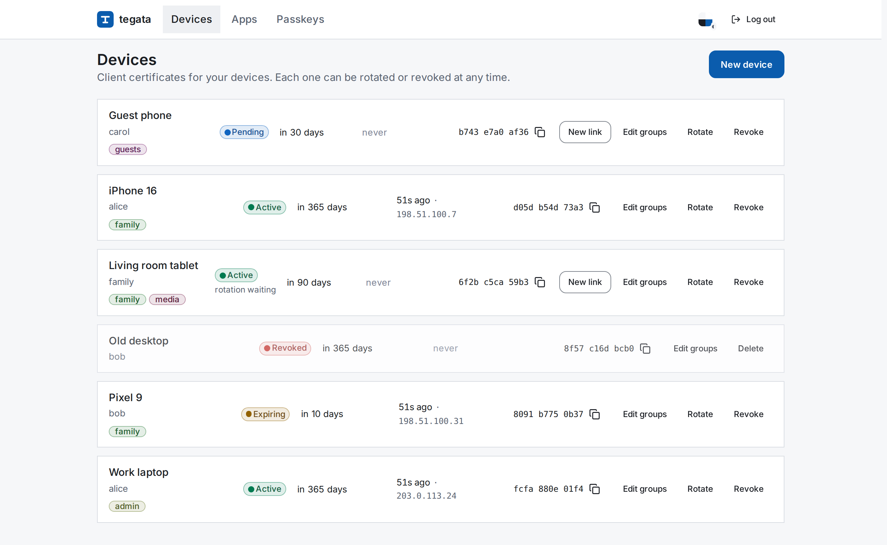
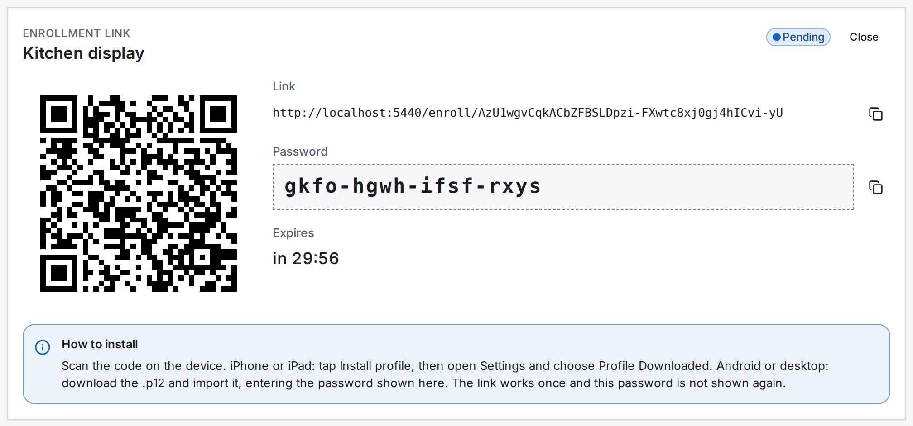

# tegata

Web UI that mints, installs, rotates and revokes mTLS client certificates for devices.

[](https://github.com/DorskFR/tegata/actions/workflows/ci.yml)

<picture>
  <source media="(prefers-color-scheme: dark)" srcset="docs/assets/devices-dark.png">
  
</picture>

Runs a client CA (built in or OpenBao PKI), enrols devices by QR code and publishes the CA
and CRL to the gateway.

## Features

- Per-device owner, groups and validity.
- One-time link: iOS profile, `.p12` elsewhere ([details](docs/devices.md)).
- Rotation without downtime.
- CA and CRL in a Kubernetes ConfigMap, or PEM over HTTP.
- Envoy `ext_authz`: last seen, instant revocation, per-app access by group.
- Passkey-only admin login.

<picture>
  <source media="(prefers-color-scheme: dark)" srcset="docs/assets/enroll-dark.png">
  
</picture>

The link only works with this password.

## Quick start

Requires Rust 1.94+ and Node 26.

```sh
git clone https://github.com/DorskFR/tegata && cd tegata
make ui
TEGATA_PUBLIC_URL=http://localhost:8080 cargo run
```

```text
WARN tegata::config: no passkey registered yet: open the app and use this setup token setup_token=tVaZ…
INFO tegata: tegata listening listen=0.0.0.0:8080 authz_listen=0.0.0.0:8081 public_url=http://localhost:8080/
```

Open http://localhost:8080, paste the setup token, register the admin passkey.

- State: `./data` (`ca/ca.key`, `ca/ca.crt`, `state.json`). Back it up.
- Passkeys require HTTPS or `localhost`.
- Devices must reach `TEGATA_PUBLIC_URL`.

## Run the container

```yaml
# compose.yaml
services:
  tegata:
    image: ghcr.io/dorskfr/tegata:0.6.0
    ports: ["8080:8080"]
    volumes: ["./data:/data"]
    environment:
      TEGATA_PUBLIC_URL: https://tegata.example.com
```

Runs as uid 65532, which must own `data`:

```sh
mkdir data && docker run --rm -v "$PWD/data:/data" busybox chown 65532:65532 /data
docker compose up -d
docker compose logs tegata | grep setup_token
```

Update: change the tag, rerun `docker compose up -d`. Gateway and OpenBao:
[docs/deployment.md](docs/deployment.md).

## Backends

| `TEGATA_BACKEND` | Certificates | State |
|---|---|---|
| `local` (default) | CA in `$TEGATA_DATA_DIR/ca`, valid 10 years | `$TEGATA_DATA_DIR/state.json` |
| `openbao` | OpenBao PKI role (the CA key never leaves OpenBao) | one KV v2 secret, check-and-set, shareable by replicas |
| `memory` | local CA | memory, for trying it out |

## Configuration

Full list: [docs/configuration.md](docs/configuration.md). API: [docs/api.md](docs/api.md).

| Variable | Default | Effect |
|---|---|---|
| `TEGATA_PUBLIC_URL` | required | URL browsers and devices use; passkeys are bound to its host |
| `TEGATA_BACKEND` | `local` | `local`, `openbao` or `memory` |
| `TEGATA_DATA_DIR` | `data` (`/data` in the image) | Where the local CA and state live |
| `TEGATA_DEFAULT_VALIDITY_DAYS` | `365` | Validity preselected for a new device |
| `TEGATA_ENROLLMENT_MINUTES` | `30` | Lifetime of a one-time install link |
| `TEGATA_TRUST_CONFIGMAP` | | `namespace/name` of the ConfigMap to fill with `ca.crt` and `ca.crl` |

## Limitations

- Every passkey is a full admin. No roles.
- No TLS termination or certificate checks; the gateway does both.
- Without `/authz` calls, revocation waits for the gateway to reload the CRL.
- Trust bundle push: Kubernetes ConfigMap only. Elsewhere, fetch `/ca.crt` and `/crl.pem`.
- PKCS#12 uses 3DES with a SHA-1 MAC: the one combination every iOS, Android, macOS,
  Windows and Firefox keystore imports.

## Development

```sh
make test          # cargo test + vitest
make lint          # rustfmt (nightly), clippy, svelte-check, prettier, eslint
make run           # server on :8080, public URL http://localhost:5173
make ui/dev        # in a second shell: Vite on :5173, proxying the API to :8080
```

## License

[WTFPL](LICENSE)
